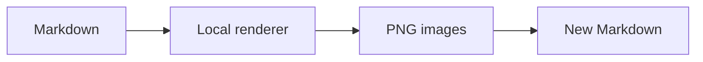

# Portable rendering demo

This synthetic sample contains no personal or research data. Drag this file into the application after extracting the portable package.

<box border radius="xl" padding={3} gap={2}>
  <row justify="between">**Local rendering demo**<badge color="success">Offline</badge></row>
  <grid columns={2} gap={2}>
    <grid-item><box background="surface-secondary" padding={3}>First column</box></grid-item>
    <grid-item><box background="surface-secondary" padding={3}>Second column</box></grid-item>
  </grid>
  <svg viewBox="0 0 300 90" width="300">
    {#each Array.from({length:12},(_,i)=>i) as i}
      <line x1={15+i*24} y1="10" x2={15+i*24} y2="80" stroke="#0d9488" strokeWidth="2"/>
    {/each}
  </svg>
  <caption>Twelve lines calculated from the original expression.</caption>
</box>



```html
<canvas id="demo" width="500" height="120"></canvas>
<script>
const context=document.getElementById('demo').getContext('2d');
context.fillStyle='#0d9488';context.fillRect(10,10,480,100);
context.fillStyle='#fff';context.font='24px sans-serif';
context.fillText('Canvas rendering works',30,70);
</script>
```

Ordinary code remains editable:

```python
print("This code is not an image.")
```
